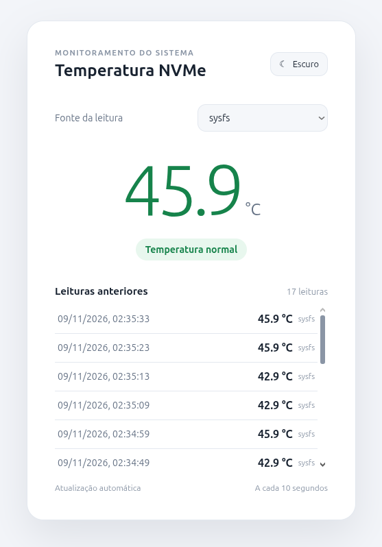

# Monitor de temperatura NVMe

Aplicação web simples para acompanhar a temperatura de um SSD NVMe. A página mostra a leitura atual, seu estado (normal, quente ou alta) e o histórico recente com horário.



## Estrutura do projeto

- `app.py`: servidor Flask, leitura do sensor e API.
- `templates/index.html`: estrutura da página.
- `static/css/styles.css`: estilos e temas.
- `static/js/app.js`: interações da interface e atualização das leituras.

## Plataformas e requisitos

O servidor Flask pode ser iniciado nos três sistemas com Python 3.9 ou superior. **A leitura automática da temperatura pelo app está integrada somente no Linux**: no Windows e no macOS, a página pode abrir, mas a temperatura aparecerá como indisponível.

| Sistema | Inicia a aplicação | Leitura da temperatura |
| --- | --- | --- |
| Linux | Sim | Sim, selecionando `sysfs` ou `smartctl` |
| Windows | Sim | Consulta manual com `smartctl`; ainda não integrada ao app |
| macOS | Sim | Consulta manual com `smartctl`; ainda não integrada ao app |

## Iniciar no Linux

Instale Python 3 e o suporte a ambientes virtuais (`venv`). Na pasta do projeto:

```bash
./run.sh
```

O script cria `.venv` e instala as dependências na primeira execução. Se necessário, use `chmod +x run.sh`. Também é possível iniciar manualmente:

```bash
python3 -m venv .venv
source .venv/bin/activate
python -m pip install -r requirements.txt
python app.py
```

## Iniciar no macOS

Instale Python 3.9 ou superior. No Terminal, na pasta do projeto:

```bash
python3 -m venv .venv
source .venv/bin/activate
python -m pip install -r requirements.txt
python app.py
```

`./run.sh` também pode ser usado no Terminal. A aplicação inicia, mas o código atual não tem um método compatível com macOS para ler a temperatura do NVMe.

## Iniciar no Windows

Instale Python 3.9 ou superior. No PowerShell, na pasta do projeto:

```powershell
py -3 -m venv .venv
.\.venv\Scripts\python.exe -m pip install -r requirements.txt
.\.venv\Scripts\python.exe app.py
```

O `run.sh` não é um script do Windows; use os comandos do PowerShell acima. A aplicação inicia, mas a leitura de temperatura do NVMe ainda não é compatível com Windows.

## Acessar a aplicação

Depois de iniciar em qualquer sistema, abra [http://localhost:5010](http://localhost:5010). Para encerrar, use `Ctrl+C` no terminal em que o app está rodando.

## Uso

- Escolha o intervalo de leitura de **10, 30 ou 60 segundos**; a preferência fica salva no navegador e o padrão é 10 segundos.
- Use o seletor **Fonte da leitura** para escolher `sysfs` ou `smartctl`; a seleção fica salva no navegador.
- O tema claro ou escuro acompanha a preferência do sistema inicialmente; a escolha manual é salva no navegador.
- O histórico mantém até 30 leituras em memória e é reiniciado quando o app para.
- `sysfs` e `smartctl` são fontes selecionadas manualmente, sem fallback automático. No modo `smartctl`, o app consulta `/dev/nvme0` com `smartctl`; esse caminho do controlador é fixo no código.

## Consultar temperatura com smartctl

`smartctl` faz parte do pacote **smartmontools**. Ele pode ser usado para consultar o SSD manualmente nos três sistemas, desde que o dispositivo e o controlador exponham os dados SMART. A disponibilidade varia conforme o hardware e os drivers.

1. Instale o **smartmontools**, que inclui o `smartctl`, usando um dos links oficiais:

   - **Linux:** [pacotes por distribuição](https://www.smartmontools.org/wiki/Packages). No Ubuntu ou Debian: `sudo apt install smartmontools`.
   - **macOS:** [downloads oficiais (DMG)](https://github.com/smartmontools/smartmontools/releases) ou [instalação pelo Homebrew](https://formulae.brew.sh/formula/smartmontools) com `brew install smartmontools`.
   - **Windows:** [instaladores oficiais](https://sourceforge.net/projects/smartmontools/files/). A [página de downloads do projeto](https://www.smartmontools.org/wiki/Download) traz instruções adicionais.

2. Liste os dispositivos que o `smartctl` reconhece:

   ```bash
   smartctl --scan-open
   ```

3. Use o identificador exibido no resultado e qualquer opção `-d` indicada para consultar o disco:

   ```bash
   sudo smartctl -a -d nvme /dev/nvme0
   ```

   No PowerShell, use `smartctl -a <dispositivo>`; se houver erro de permissão, execute o terminal como administrador. Procure a linha `Temperature` na seção de informações SMART/NVMe.

Para usar o seletor `smartctl` no app Linux, autorize somente a consulta do NVMe sem senha, pois a leitura acontece em segundo plano:

```bash
command -v smartctl
sudo visudo -f /etc/sudoers.d/nvme-monitor
```

No arquivo aberto pelo `visudo`, adicione uma linha substituindo `<usuario>` pelo resultado de `whoami` e `/usr/sbin/smartctl` pelo caminho retornado por `command -v`:

```text
<usuario> ALL=(root) NOPASSWD: /usr/sbin/smartctl -a -d nvme /dev/nvme0
```

Salve e feche o editor. Essa regra permite somente a leitura SMART desse dispositivo pelo comando indicado. Se `smartctl --scan-open` apontar outro controlador, ajuste o caminho no app e nessa regra.

Os comandos manuais permitem verificar o sensor nos três sistemas. No app, a opção `smartctl` está integrada apenas ao Linux; no Windows e no macOS, use a consulta manual até haver uma integração própria para cada sistema.

## API

`GET /api/temp` retorna a temperatura atual e o histórico em JSON. Use `source=sysfs` ou `source=smartctl` para escolher a fonte; sem esse parâmetro, a API usa `sysfs`. `temp` será `null` quando não for possível obter uma leitura. Uma fonte inválida retorna HTTP 400.

Exemplos: `GET /api/temp?source=sysfs` e `GET /api/temp?source=smartctl`.

```json
{
  "temp": 42.5,
  "source": "sysfs",
  "history": [
    {
      "temp": 42.5,
      "time": "2026-11-09T02:07:16-03:00",
      "source": "sysfs"
    }
  ]
}
```
